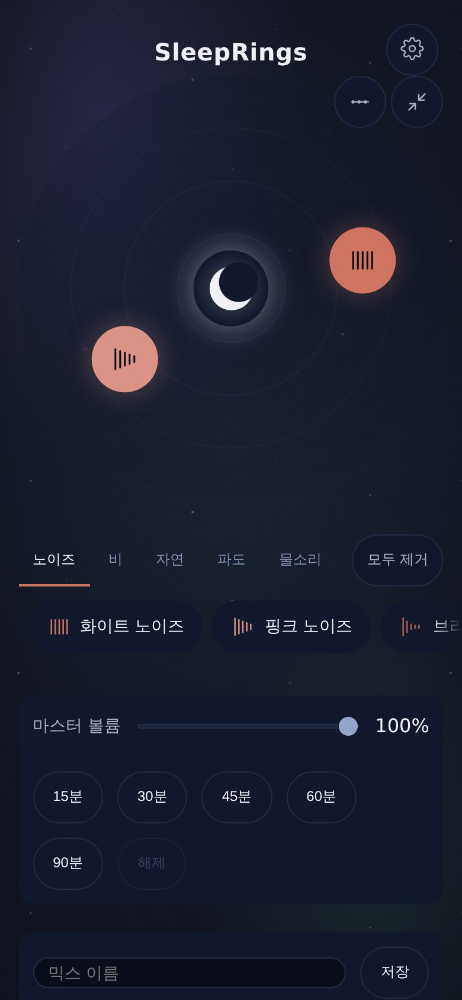
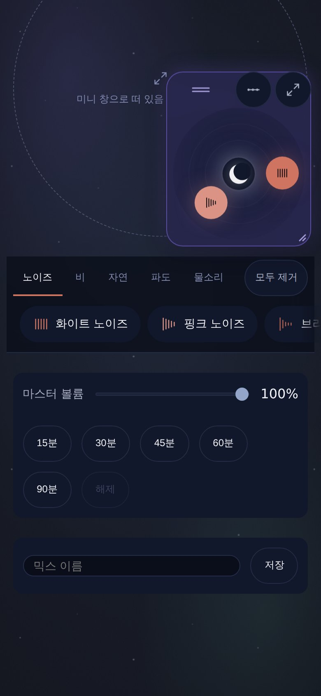
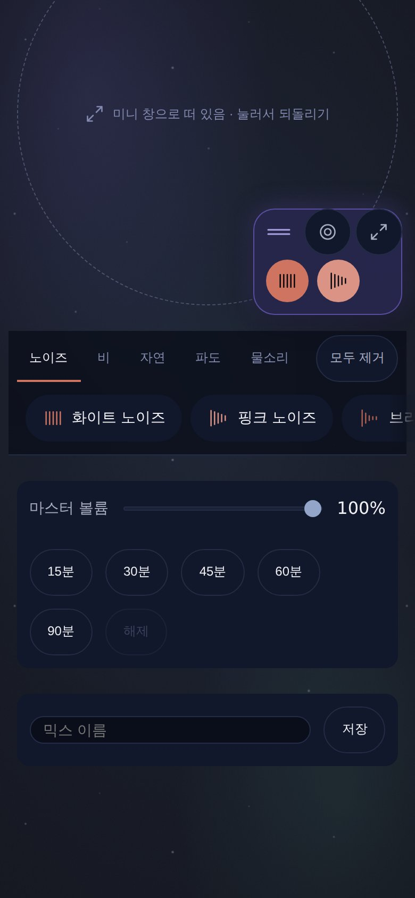
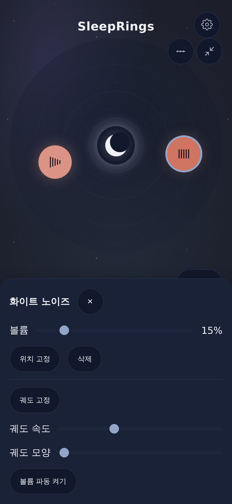

# SleepRings

동심원 위에 소리를 올려 나만의 수면 사운드를 섞는 앱. 중심(머리)에서의 **거리 = 볼륨**,
**각도 = 공간감(바이노럴)**이고, 올린 소리는 궤도를 따라 천천히 돈다.
웹(React + Vite)으로 만들고 Capacitor로 Android·iOS 앱을 같은 코드에서 빌드한다.

**웹 버전:** https://sleep-rings.hyuckjin.workers.dev

| 오빗 믹서 | 플로팅 미니 창 | 일자형(ㅡ) 보기 | 사운드 조절 |
|---|---|---|---|
|  |  |  |  |

## 주요 기능

- **오빗 믹서** — 칩을 원 위로 드래그/탭해 배치, 오브를 끌어 볼륨·방향 조절, 아래 삭제 영역으로 제거
- **궤도 모션** — 오브별 랜덤/고정/스와이프 궤도, 속도·모양 조절, 잠금
- **화면 구성 4종** — 컨트롤을 쓰는 동안 오빗을 어떻게 보여줄지 설정에서 선택
  - 바텀시트(기본): 시트를 끌어올리는 만큼 오빗이 연속으로 작아짐
  - 접는 헤더: 스크롤하면 오빗이 상단 바(썸네일 + 아이콘 줄)로 접힘
  - 미니 바: 오빗이 화면 밖으로 나가면 하단 재생 바가 올라옴
  - 플로팅: 항상 위의 작은 창(이동·크기 조절, 일자형(ㅡ) 아이콘 보기)
- **라이트 / 다크 테마** — 시스템 설정을 따르거나 직접 선택
- **사운드** — 합성 노이즈(화이트·핑크·브라운·그린 등) + 자연음, 카테고리 탭
- **수면** — 마스터 볼륨, 슬립 타이머(페이드아웃), 믹스 자동 저장·프리셋, 화면 어둡게
- **백그라운드 재생** — 무음 킵얼라이브 + Android 포그라운드 서비스
- **한국어 / 영어** — 설정에서 선택(저장됨), 처음엔 기기 언어를 따름
- **수익화** — 무료 + 유료 티어(RevenueCat), 배너 광고(AdMob). 둘 다 키·광고 ID 설정 전이라 현재는 비활성/테스트 ID

## 시작하기

Node.js 22 이상.

```bash
npm install
npm run dev          # 개발 서버
npm run web          # 빌드 후 http://127.0.0.1:4173 에서 미리보기
npm run web:tunnel   # (web 실행 중, 다른 터미널) Cloudflare 임시 링크로 폰에서 접속 — cloudflared 필요
npm run deploy:web   # 빌드 후 Cloudflare(무료, 정적 호스팅)에 배포 — 고정 주소, wrangler 로그인 필요
```

## 테스트

```bash
npm run typecheck
npm test             # 단위 테스트 (Vitest)
npm run test:e2e     # E2E (Playwright)
```

WSL의 `/mnt/d`처럼 느린 파일시스템에서는 Vitest를 파일 단위 직렬로 돌린다(`vite.config.ts` 참고).

## 모바일 빌드

| 플랫폼 | 명령 | 문서 |
|---|---|---|
| Android | `npm run build:android` (서명 AAB + APK, JDK 21 필요) | [docs/android-build.md](docs/android-build.md) |
| iOS | `npm run build:ios` 후 macOS의 Xcode에서 빌드·서명 | [docs/ios-build.md](docs/ios-build.md) |

앱 ID `com.sleeprings.app`. 광고·결제 키 연결은 [docs/ads-setup.md](docs/ads-setup.md),
[docs/plan-tiers.md](docs/plan-tiers.md).

## 릴리즈

로컬에서 `npm run release`(commit-and-tag-version)로 버전·[CHANGELOG.md](CHANGELOG.md)·태그를 만든다.
기능 릴리즈는 `npm run release -- --release-as minor`. 자세한 규칙은 [docs/RELEASE.md](docs/RELEASE.md).

## 구조

```
src/
  app/       앱 셸, 설정 화면, 테마 토큰
  mixer/     오빗 필드·오브·팔레트·플로팅 독, 믹스 상태(zustand)
  audio/     Web Audio 엔진 — 노이즈 합성, 공간화, 로더
  library/   사운드 카탈로그
  sleep/     타이머·프리셋·저장
  plan/ ads/ 유료 티어·광고
  mobile/    백그라운드 재생, 포그라운드 서비스, 햅틱
  screen/    화면 어둡게·wake lock
docs/        설계(design/), 빌드, 사운드 출처·라이선스, 스토어 자료
scripts/     사운드 파이프라인, 스토어 스크린샷, 릴리즈 updater
```

## 사운드 라이선스

자연음은 CC0 음원만 쓰며 출처를 [docs/sound-licenses.md](docs/sound-licenses.md)에 기록한다.
일부 자연음 파일은 아직 저장소에 없어서 [docs/sound-manual-downloads.md](docs/sound-manual-downloads.md)
절차대로 받아야 재생된다.
